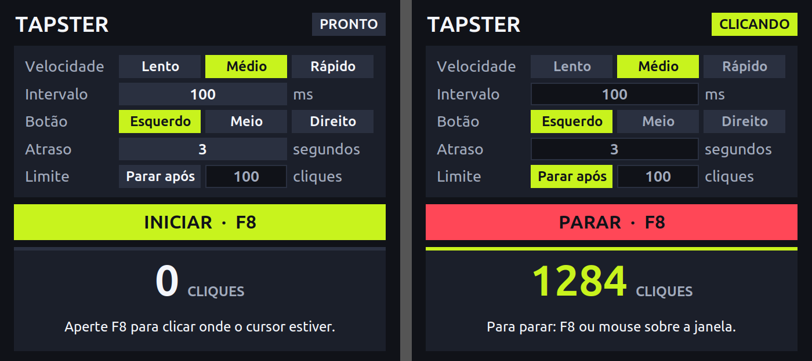

# Tapster

Autoclicker simples para Linux, com interface gráfica e atalho global. Funciona em sessões Wayland sem `sudo`, usando o portal RemoteDesktop do sistema.



## Recursos

- Intervalo ajustável de 10 ms a 1 hora, com opções prontas: Lento, Médio e Rápido
- Botão esquerdo, do meio ou direito do mouse
- Atraso antes de começar e limite opcional de cliques
- Início e parada pelo F8, depois de configurar o atalho
- Parada ao passar o mouse sobre a janela, que fica sempre visível
- Contador de cliques em tempo real

## Requisitos

- Linux com GNOME em sessão Wayland (desenvolvido no Ubuntu 26.04 com GNOME 50; outros ambientes não foram testados)
- Python 3 com `python3-tk` e `python3-gi`
- `xdg-desktop-portal` com um backend que ofereça RemoteDesktop

No Ubuntu:

```bash
sudo apt install python3-tk python3-gi xdg-desktop-portal-gnome
```

## Instalação

```bash
git clone https://github.com/Maihrendson/tapster.git
cd tapster
./bin/tapster
```

### Atalho no menu de aplicativos (opcional)

Execute dentro da pasta do projeto:

```bash
mkdir -p ~/.local/share/applications
cat > ~/.local/share/applications/tapster.desktop <<EOF
[Desktop Entry]
Type=Application
Name=Tapster
Comment=Autoclicker simples
Exec="$PWD/bin/tapster"
Path=$PWD
Icon=$PWD/assets/tapster.svg
Terminal=false
Categories=Utility;
StartupWMClass=Tapster
EOF
```

Para também ter o ícone na Área de Trabalho, copie esse arquivo para lá. Depois, clique nele com o botão direito e escolha **Permitir iniciar**.

### Tecla F8 (opcional)

O Wayland não deixa um app comum ouvir teclas globalmente, então o atalho é criado no GNOME:

1. Abra *Configurações → Teclado → Atalhos de teclado → Atalhos personalizados*.
2. Adicione um atalho com o nome `Tapster` e a tecla `F8`.
3. No comando, use o caminho completo do arquivo, seguido de `--toggle`. Se o caminho tiver espaços, coloque-o entre aspas:

```text
/caminho/para/tapster/bin/tapster --toggle
```

Enquanto o atalho existir, os outros aplicativos não recebem essa tecla. Você pode escolher outra tecla, mas os textos da janela continuam mencionando o F8.

## Como usar

1. Abra o Tapster e ajuste a velocidade e o botão do mouse.
2. Leve o cursor até o ponto desejado, fora da janela, e aperte **F8**. Se preferir, clique em **Iniciar** e use o atraso para posicionar o cursor.
3. Na primeira vez, autorize o controle do mouse no diálogo do sistema. Depois da autorização, há pelo menos 3 segundos para levar o cursor ao lugar certo.
4. Para parar, aperte **F8** ou passe o mouse sobre a janela do Tapster.

O clique acontece onde o cursor estiver. Pelo F8, os cliques começam sem o atraso configurado. Com a janela fechada, o F8 só abre o app, sem clicar.

## Como funciona

```text
F8 → atalho do GNOME → bin/tapster --toggle → socket Unix → janela aberta
                                                                    │
                                      portal RemoteDesktop ← cliques ┘
```

- **Cliques:** são enviados pelo portal RemoteDesktop (`xdg-desktop-portal`), que pede a autorização do usuário.
- **Interface:** usa Tkinter pelo XWayland, o que permite manter a janela sempre no topo.
- **Instância única:** abrir o app de novo reaproveita a janela existente.

## Limitações

- Não clica em coordenadas fixas, apenas na posição atual do cursor.
- O portal limita a velocidade real: cada clique dura pelo menos 15 ms, então intervalos muito curtos podem não ser atingidos.

## Privacidade

O app não usa a rede. Depois da primeira autorização, guarda um token em `~/.config/tapster/restore_token` para evitar novos pedidos. Apague esse arquivo para esquecer a autorização.

## Estrutura do projeto

```text
bin/tapster          abre o app sem exigir instalação
assets/              ícone
docs/                imagem do README
tests/               um arquivo de teste por módulo
tapster/
├── cli.py           linha de comando e montagem do app
├── settings.py      opções de clique e validação dos campos
├── engine.py        repetição dos cliques em segundo plano
├── portal.py        envio dos cliques pelo portal RemoteDesktop
├── ipc.py           comandos entre processos e instância única
├── paths.py         locais dos arquivos criados pelo app
├── errors.py        erro compartilhado entre os módulos
└── ui/
    ├── app.py       estados e comportamento
    ├── window.py    desenho da janela
    ├── theme.py     cores e aparência de cada estado
    └── state.py     estados possíveis do app
```

Só `portal.py` conhece o portal do sistema. Para outro método de envio de cliques, basta entregar ao `TapsterApp` um objeto com `connected`, `connect()` e `click(codigo_do_botao)`.

## Testes

```bash
python3 -m unittest -v
```

Os testes usam um clicador simulado e abrem uma janela oculta, por isso precisam de uma sessão gráfica. Eles não enviam cliques reais.

## Licença

Distribuído sob a [licença MIT](LICENSE).
